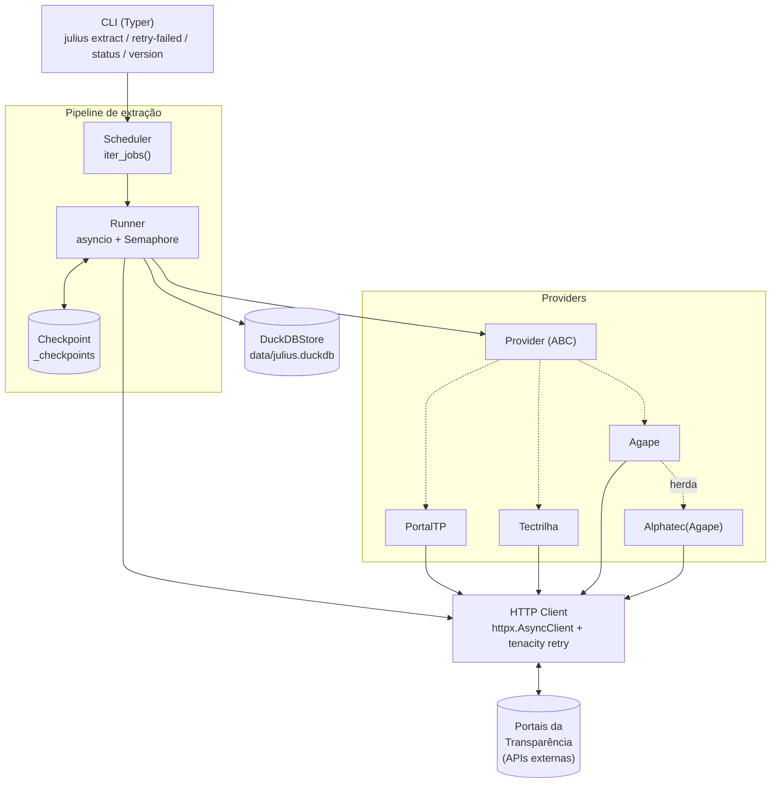
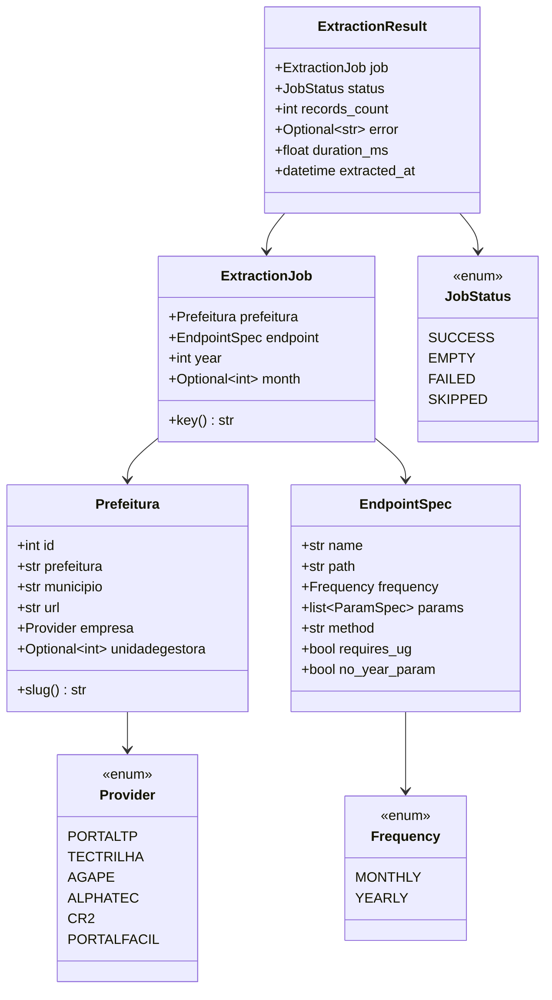
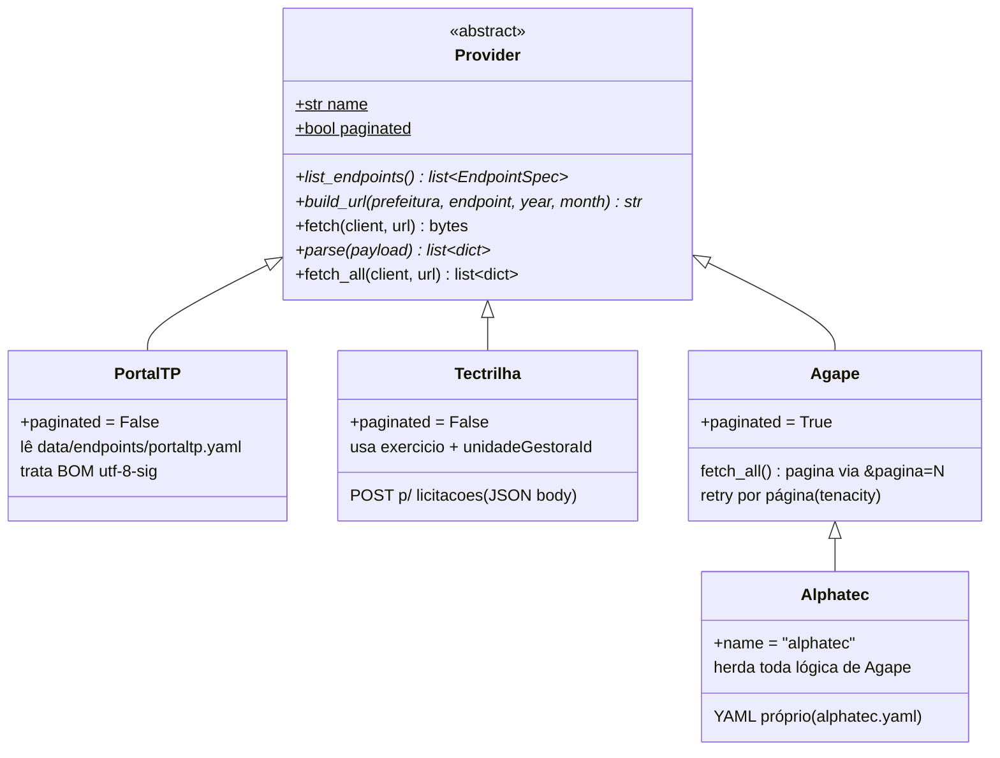
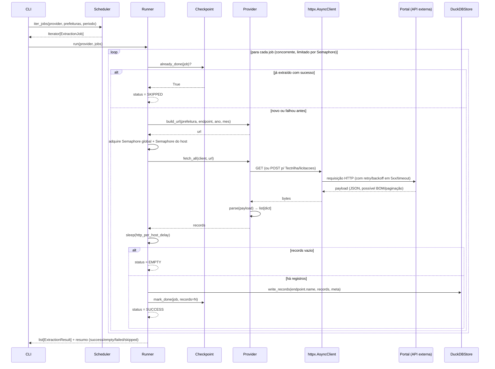
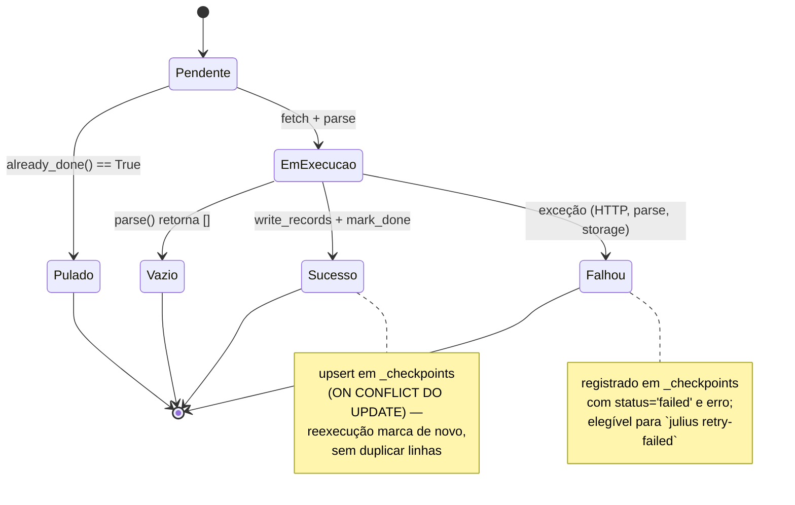

# Arquitetura — Julius 2.0

> Documento técnico vivo. Atualizar quando houver mudança estrutural relevante.
> Reflete o estado real do código (Fases 0–3 concluídas) — não um plano aspiracional.

## 1. Visão de alto nível



## 2. Componentes

### 2.1 CLI (`julius/cli.py`)

App Typer, mensagens em PT-BR, sem prompts interativos (compatível com cron/Airflow/Docker).

Comandos implementados hoje:

```
julius version
julius extract --provider <nome> --from MM/AAAA --to MM/AAAA [--only <slug>] [--dry-run]
julius extract --all --from MM/AAAA --to MM/AAAA
julius retry-failed [--provider <nome>]
julius status
```

> `pipeline normalize/unify/format-processo` e `migrate-sqlite` estão no backlog da
> [Fase 5](../todo.md) — ainda não implementados.

### 2.2 Models (`julius/models/`)

Pydantic v2. Imutáveis, validados na borda (CSV → `Prefeitura`, YAML → `EndpointSpec`).



Notas:

- `Prefeitura.slug` deriva um identificador URL-friendly de `municipio` (remove acentos,
  troca espaços por `-`). Usado no filtro `--only` da CLI e como parte da `job.key`.
- `ExtractionJob.key` é a chave de idempotência:
  `"{empresa}|{slug}|{endpoint.name}|{year}[|{month:02d}]"`.
- `EndpointSpec` carrega flags específicas de provider (`requires_ug`, `no_year_param`,
  `method`) que só fazem sentido para alguns deles — mantidas no modelo genérico para
  evitar subclasses de `EndpointSpec` por provider.

### 2.3 Providers (`julius/providers/`)

ABC `Provider` define a interface comum; cada implementação encapsula as quirks de
um portal. Registro via decorator `@register` em `registry.py`, disparado no import
de `julius/providers/__init__.py`.



| Provider | Municípios | Paginação | `fetch()` customizado | YAML de endpoints |
|---|---|---|---|---|
| `PortalTP` | 60 | não | não (GET padrão) | `data/endpoints/portaltp.yaml` |
| `Tectrilha` | 6 | não | sim — POST p/ `licitacoes` | `data/endpoints/tectrilha.yaml` |
| `Agape` | 5 | sim | não, mas `fetch_all()` próprio | `data/endpoints/agape.yaml` |
| `Alphatec` | 3 | sim (herdado) | herdado | `data/endpoints/alphatec.yaml` |

Detalhes de cada API (URLs, parâmetros, quirks) estão em [providers.md](providers.md).

### 2.4 HTTP (`julius/http/`)

- **`client.py`** — `make_client()`: factory de `httpx.AsyncClient` com timeout,
  `User-Agent` customizado, `follow_redirects=True` e limites de conexão derivados
  de `settings.http_concurrency`.
- **`retry.py`** — `fetch_with_retry`: decorator `tenacity` com backoff exponencial
  (`retry_backoff_base` × 1, 2, 4...), até `retry_max_attempts` tentativas. Só
  re-tenta em `TimeoutException`, `ConnectError` ou `HTTPStatusError` com status ≥ 500
  (erros 4xx não são re-tentados — são considerados definitivos).

### 2.5 Extractor (`julius/extractor/`)

- **`scheduler.py`** — `iter_jobs(provider, prefeituras, *, start, end)`: gera um
  `ExtractionJob` para cada combinação `(prefeitura, endpoint, período)`. Endpoints
  `MONTHLY` geram um job por mês no intervalo; `YEARLY` geram um job por ano.
- **`checkpoint.py`** — classe `Checkpoint`, tabela `_checkpoints` no DuckDB
  (`job_key TEXT PRIMARY KEY`). Operações `already_done()`, `mark_done()`,
  `mark_failed()`, `failed_jobs()`, `summary()`. `ON CONFLICT (job_key) DO UPDATE`
  garante upsert idempotente — reexecuções não duplicam.
- **`runner.py`** — classe `Runner`, orquestra a extração assíncrona:
  - `asyncio.Semaphore(http_concurrency)` global + `Semaphore(1)` por host
    (derivado do `netloc` da URL) para enforçar **1 requisição simultânea por
    portal**, evitando bloqueio de IP.
  - Após cada requisição: `await asyncio.sleep(http_per_host_delay)`.
  - Providers não-paginados passam por `fetch_with_retry`; providers paginados
    (`provider.paginated == True`) gerenciam o próprio retry por página dentro de
    `fetch_all()` — o runner não envolve a chamada externa em retry duplo.
  - Resultado de cada job vira `ExtractionResult` com status
    `success` / `empty` / `failed` / `skipped`.

### 2.6 Storage (`julius/storage/`)

DuckDB em arquivo único (`data/julius.duckdb`, configurável via `JULIUS_DB_PATH`).

- **`duckdb_store.py`** — classe `DuckDBStore`:
  - `write_records(table, records, meta)`: cria a tabela na primeira escrita
    (todas as colunas `TEXT`), insere em lote via `executemany`.
  - **Normalização de nomes** (`_safe()`): aplica `unicodedata.normalize("NFD")` +
    encode ASCII para remover diacríticos (`ç → c`, `ã → a`), depois regex para
    `snake_case`. Aplicado a nomes de tabela e de coluna.
  - **Resolução de conflito chave-API vs. metadado**: as chaves de cada registro
    da API são normalizadas *primeiro*; metadados (`municipio`, `prefeitura`,
    `provider`, `ano`, `mes`, `extracted_at`) só são adicionados quando não colidem
    com um campo já normalizado vindo da API. Isso evita o erro
    `Column with name 'X' already exists!` quando a API usa `Ano`/`ANO`/`ano`.
  - **Evolução de schema**: se um lote trouxer colunas novas, `ALTER TABLE ADD COLUMN`
    é aplicado antes do insert — sem perder dados já gravados.
  - Valores não-primitivos (`list`, `dict`) são serializados como string JSON
    (`_serialize()`) antes da gravação — DuckDB armazena tudo como `TEXT` na ingestão;
    tipagem fica para o pipeline de normalização (Fase 5).
- **`prefeituras.py`** — `load_prefeituras(path, *, provider, slug)`: lê
  `data/prefeituras.csv`, valida cada linha como `Prefeitura` (linhas inválidas são
  ignoradas), filtra por provider e/ou slug.

### 2.7 Pipelines (`julius/pipelines/`)

📋 **Backlog — Fase 5** (ver [todo.md](../todo.md)). Pacote existe (`__init__.py`)
mas ainda sem implementação. Vai concentrar transformações pós-ingestão idempotentes:
`normalize` (nomes/tipos/dedup), `unify` (consolidar entidades entre providers),
`format_processo` (Tectrilha: `processo/ano`).

### 2.8 Analysis (`julius/analysis/`)

Placeholder (`__init__.py` vazio). Fora do escopo das Fases 0–6 — tipologias de
improbidade administrativa entram na Fase 7.

## 3. Fluxo de extração



Pontos-chave:

1. **Idempotência primeiro** — todo job passa por `already_done()` antes de qualquer
   requisição. Reexecutar `julius extract` no mesmo período não duplica dados nem
   refaz trabalho concluído.
2. **Falha isolada** — exceções em um job são capturadas, registradas via
   `checkpoint.mark_failed()` e logadas; o restante da extração continua
   (`asyncio.gather` coleta todos os resultados, sucesso ou falha).
3. **Rate limiting em duas camadas** — Semaphore global (`http_concurrency`,
   default 20) limita o total de requisições simultâneas; Semaphore por host
   (sempre 1) garante que cada portal recebe no máximo uma requisição por vez,
   complementado por um delay configurável (`http_per_host_delay`, default 1s).

## 4. Máquina de estados de um job



Estados refletidos em `JobStatus` (`success`, `empty`, `failed`, `skipped`) e
persistidos na coluna `status` de `_checkpoints`.

## 5. Configuração

`.env` carregado por `pydantic-settings` (prefixo `JULIUS_`). Definido em
`julius/config.py` (`Settings`):

```bash
JULIUS_DATA_DIR=./data
JULIUS_DB_PATH=./data/julius.duckdb
JULIUS_LOG_DIR=./logs

JULIUS_HTTP_TIMEOUT=30.0
JULIUS_HTTP_CONCURRENCY=20
JULIUS_HTTP_PER_HOST_DELAY=1.0
JULIUS_HTTP_USER_AGENT="Julius/2.0 (...)"

JULIUS_RETRY_MAX_ATTEMPTS=3
JULIUS_RETRY_BACKOFF_BASE=1.0

JULIUS_LOG_LEVEL=INFO
```

## 6. Logs

`structlog` configurado em `julius/logging.py` com dois sinks compartilhando os
mesmos *processors* (timestamp ISO, nível, contexto):

- **Console** (`stdout`): `ConsoleRenderer` formatado para humanos, nível
  configurável via `JULIUS_LOG_LEVEL` (default `INFO`).
- **Arquivo** (`logs/julius.jsonl`): `JSONRenderer`, todos os níveis (`DEBUG+`),
  uma linha JSON por evento — consumível por ferramentas de observabilidade.

Eventos canônicos emitidos pelo `Runner`: `extraction.started`,
`extraction.job.skipped`, `extraction.job.empty`, `extraction.job.success`,
`extraction.job.failed`, `extraction.finished`, além de `http.request` (debug).

## 7. Testes

Estratégia em camadas (60+ testes em `tests/`):

- **Unit** — `build_url()`, `parse()`, validators de model (`Prefeitura.slug`,
  coerção de `unidadegestora`), `iter_jobs()`, `_safe()`/`_serialize()` do storage.
- **Integration (mock HTTP)** — `respx` mocka respostas HTTP; testa `fetch_all()`
  paginado do Agape, runner end-to-end contra `DuckDBStore(":memory:")`.
- **Fixtures reais** — `tests/fixtures/{provider}/` guarda payloads JSON capturados
  de prefeituras reais (ex: `licitacoes_2024_01.json` da Afonso Cláudio,
  `empenhos_2024_01_p1.json` do Agape) para validar `parse()` contra dados reais.

## 8. Decisões registradas (ADRs)

- [0001 — Storage: DuckDB](decisions/0001-storage-duckdb.md)
- [0002 — HTTP: httpx async](decisions/0002-http-async-httpx.md)
- [0003 — CLI: Typer](decisions/0003-cli-typer.md)
- [0004 — Rollout: faseado](decisions/0004-phased-rollout.md)
- [0005 — Idioma: código EN, CLI PT-BR](decisions/0005-idioma-codigo-cli.md)

## 9. Documentos relacionados

- [providers.md](providers.md) — catálogo detalhado de cada API de provider
  (URLs, parâmetros, paginação, quirks descobertas).
- [conventions.md](conventions.md) — convenções de código, commits e idioma.
- [../plan.md](../plan.md) — roadmap por fases com babysteps.
- [../todo.md](../todo.md) — backlog da Fase 5 (pipelines + migração).
